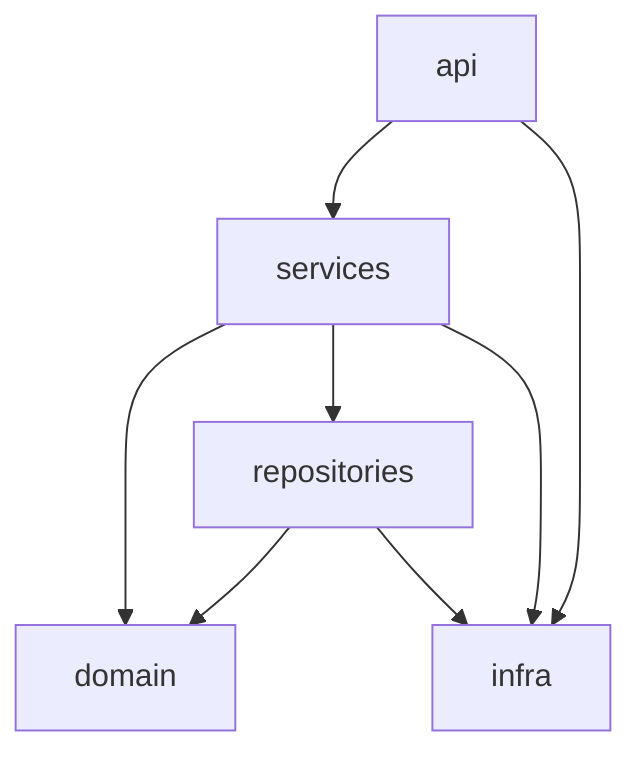
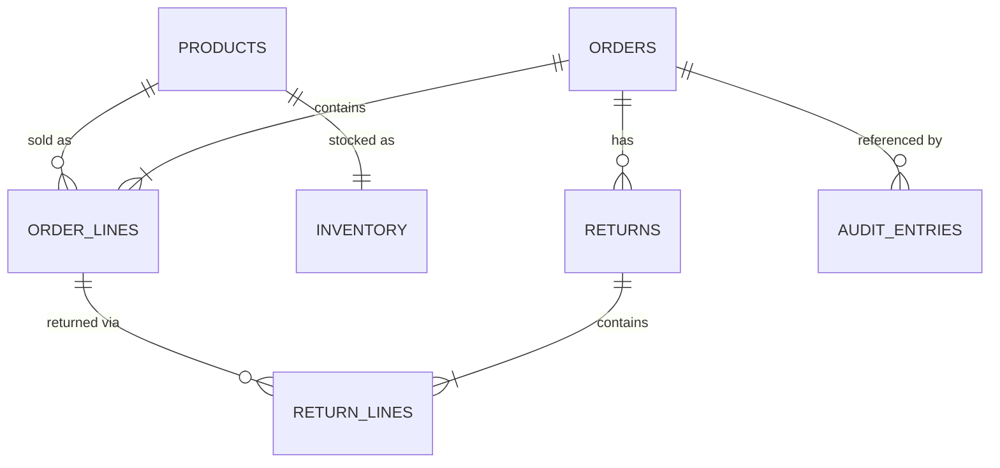
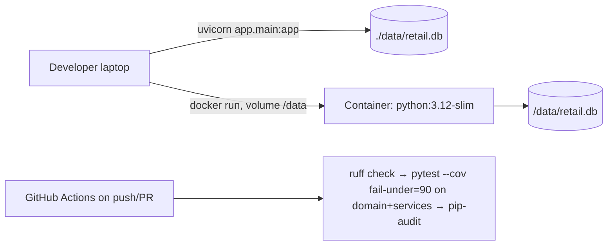

# Architecture Spine — retail-agent

## Design Paradigm

**Layered, with a pure functional domain core.** Routes are thin. Services handle orchestration and transactions. All business rules live in pure domain functions that never do I/O. Repositories are the only code that touches SQL.

| Layer | Package | Owns |
| --- | --- | --- |
| API | `app/api/` | FastAPI routers, Pydantic request/response schemas, mapping errors to HTTP |
| Services | `app/services/` | Use cases, transaction boundaries, audit calls |
| Domain | `app/domain/` | Entities (frozen dataclasses), eligibility rules, refund maths, `DomainError` |
| Repositories | `app/repositories/` | SQL against SQLite, mapping rows to domain objects |
| Infra | `app/infra/` | DB connection, schema and seed loading, settings, clock |



Dependencies only point downward, as drawn. `domain` imports nothing from `fastapi`, `pydantic`, `sqlite3` or any other `app` package.

## Invariants & Rules

### AD-1 — Business rules live only in the domain core
- **Binds:** FR-2, FR-4, FR-5
- **Prevents:** The window, quantity and refund rules being re-implemented in routes or SQL and drifting apart.
- **Rule:** Eligibility (`check_return_eligibility`), Returnable Quantity and Refund calculation are pure functions in `app/domain/`. They take every input, including `today`, as an argument. Routes and repositories never decide eligibility or compute money.

### AD-2 — A Return is one service operation in one transaction
- **Binds:** FR-3, FR-4, FR-5, FR-6, FR-7
- **Prevents:** Partial writes (a refund recorded but no restock), and two concurrent requests both passing the quantity check.
- **Rule:** `ReturnService.create_return` is the **only** writer of `returns`, `return_lines` and `inventory`. It opens a `BEGIN IMMEDIATE` transaction, re-reads the Order and the quantities already returned, runs the domain checks, and then writes the Return, Refund, Restock and Audit Entries before a single commit. It rolls back everything on any error. The one exception is the seed loader (FR-10), which runs only against an empty database.

### AD-3 — Money is integer cents everywhere
- **Binds:** FR-1, FR-2, FR-5
- **Prevents:** Float rounding errors, and one module using dollars while another uses cents.
- **Rule:** Every amount is an `int` number of cents in SQLite (`INTEGER`), in the domain, and in the API, where fields are suffixed `_cents`. There is one currency and it is never stored. No `float` or `Decimal` is used for money.

### AD-4 — Time comes from an injected clock
- **Binds:** FR-2, FR-4, FR-7
- **Prevents:** Return Window tests that pass or fail depending on the real date, and modules disagreeing on the day-30 boundary.
- **Rule:** The current time comes only from a `Clock` dependency (`app/infra/clock.py`). Tests override it with FastAPI `dependency_overrides`. A request is inside the window when `today <= delivered_on + timedelta(days=30)`, with `today` taken as the UTC date. Nothing calls `datetime.now()` or `date.today()` outside `Clock`.

### AD-5 — The audit trail has one writer and is append-only
- **Binds:** FR-7, FR-8
- **Prevents:** Each service writing its own audit format, rows being edited, and raw emails leaking into the log.
- **Rule:** Services write Audit Entries only through `AuditRepository.record(action, order_id, outcome, details)`. Routes and domain code never write them. `record` masks any email (`a***@example.com`) before storing it. SQLite triggers abort any `UPDATE` or `DELETE` on `audit_entries`. Audit Entries for an accepted Return go in the AD-2 transaction. A rejected request or a lookup writes its Audit Entry in a separate transaction of its own, which is committed even though the request itself fails.

### AD-6 — One error model
- **Binds:** FR-1, FR-4, all endpoints
- **Prevents:** Endpoints each inventing their own error shapes and status codes.
- **Rule:** The domain and services raise `DomainError(code)`, where `code` is one of a fixed set of values. A single exception handler maps `code` to an HTTP status and returns `{"error": {"code": "...", "message": "..."}}`. `ORDER_NOT_FOUND` → 404, and it covers both an unknown ID and a wrong email. Eligibility rejections → 422: `ORDER_NOT_DELIVERED`, `RETURN_WINDOW_EXPIRED`, `INVALID_QUANTITY`, `LINE_NOT_ON_ORDER`. Malformed bodies use the same envelope with `VALIDATION_ERROR` → 422.

### AD-7 — Persistence uses stdlib `sqlite3` with no ORM
- **Binds:** all repositories, FR-10
- **Prevents:** Mixing an ORM with raw SQL, and more than one schema source.
- **Rule:** `app/infra/schema.sql` is the only schema definition, applied with `CREATE TABLE IF NOT EXISTS` at startup. The fixed seed set loads only when `orders` is empty. One connection per request is provided as a FastAPI dependency. SQL appears only in `app/repositories/`. There is no migration tool: a schema change means deleting the DB file.

### AD-8 — Pydantic stays at the boundary
- **Binds:** `app/api/`, `app/domain/`
- **Prevents:** Framework types leaking into the domain, and two model hierarchies for one entity.
- **Rule:** Pydantic models exist only in `app/api/schemas.py`. The domain uses frozen `@dataclass`es. The API layer converts between the two explicitly.

### AD-9 — Customer email is never in a URL
- **Binds:** FR-1, FR-3
- **Prevents:** Emails showing up in access logs and browser history.
- **Rule:** Lookup and return requests send `order_id` and `email` in a JSON POST body (see the endpoint table under Structural Seed).

## Consistency Conventions

| Concern | Convention |
| --- | --- |
| Naming | `snake_case` for modules, functions and JSON fields. Plural table names. Services are named `<Noun>Service` and repositories `<Noun>Repository`. |
| IDs | Order IDs are seeded strings (`ORD-1001`). Order Line, Return and Audit Entry IDs are SQLite `INTEGER` autoincrement values. |
| Dates & times | ISO 8601. Dates are `YYYY-MM-DD`. Timestamps are UTC with a `Z` suffix. |
| Glossary | Code uses the PRD §3 terms (`Order`, `OrderLine`, `Return`, `Refund`, `Restock`, `AuditEntry`, `returnable_quantity`), with no synonyms. |
| Config | Environment variables with safe defaults (`RETAIL_DB_PATH=./data/retail.db`), read once in `app/infra/settings.py`. No `.env` files. |
| Audit Entry shape | `action` is one of `ORDER_LOOKUP`, `RETURN_REQUESTED`, `REFUND_CALCULATED`, `RESTOCK_APPLIED`. `outcome` is `success`, `rejected` or `not_found`. `details` is a JSON object whose keys are `snake_case`, and a rejection includes its `error_code`. |
| Logging | stdlib `logging` to stdout. Never log a full email. |
| Tests | `tests/unit/` covers the domain with no DB. `tests/api/` uses `TestClient` against a temporary SQLite file and a fixed `Clock`. Each test docstring names the FR it covers. |

## Stack

| Name | Version |
| --- | --- |
| Python | 3.12 |
| FastAPI | 0.165.0 |
| Pydantic | 2.14.3 |
| Uvicorn | 0.54.0 |
| SQLite (stdlib `sqlite3`) | bundled with Python 3.12 |
| pytest | 9.2.0 |
| pytest-cov | 7.1.0 |
| httpx | 0.28.1 |
| Ruff | 0.17.5 |
| pip-audit | 2.10.1 |
| Docker base image | python:3.12-slim |

Exact versions are pinned in `requirements.txt` (runtime) and `requirements-dev.txt` (tooling).

## Structural Seed

**Endpoints**

| Method | Path | FR |
| --- | --- | --- |
| POST | `/orders/lookup` | FR-1, FR-2 |
| POST | `/returns` | FR-3 – FR-6 |
| GET | `/audit?order_id=` | FR-8 |
| GET | `/healthz` | FR-9 |
| GET | `/docs` | FR-9 (FastAPI built-in) |





```text
retail-agent/
  app/
    main.py            # app factory, router + error-handler registration, startup schema/seed
    api/               # routers per resource, schemas.py, errors.py (AD-6)
    services/          # order_service.py, return_service.py, audit_service.py
    domain/            # models.py, rules.py (eligibility, refund), errors.py
    repositories/      # orders, returns, inventory, audit
    infra/             # db.py, schema.sql, seed.py, settings.py, clock.py
  tests/
    unit/  api/
  Dockerfile
  requirements.txt  requirements-dev.txt
  .github/workflows/ci.yml
```

## Capability → Architecture Map

| Capability | Lives in | Governed by |
| --- | --- | --- |
| FR-1 Look up an Order | `api/orders`, `services/order_service`, `repositories/orders` | AD-6, AD-9 |
| FR-2 Show return eligibility | `domain/rules`, `services/order_service` | AD-1, AD-3, AD-4 |
| FR-3, FR-4 Request a Return and enforce rules | `api/returns`, `services/return_service`, `domain/rules` | AD-1, AD-2, AD-4, AD-6 |
| FR-5 Refund | `domain/rules` | AD-1, AD-3 |
| FR-6 Restock | `services/return_service`, `repositories/inventory` | AD-2 |
| FR-7, FR-8 Audit trail | `repositories/audit`, `api/audit` | AD-5 |
| FR-9 Health and API docs | `api/health`, FastAPI `/docs` | AD-6 |
| FR-10 Seeded mock data | `infra/seed.py` | AD-7 |

## Assumptions

1. Stdlib `sqlite3` with no ORM is simple enough for the lab (AD-7).
2. Schema changes during the lab are handled by deleting the DB file, not by migrations (AD-7).
3. Money is exposed as integer `_cents` fields in the API, not as decimal strings (AD-3).
4. Lookup uses `POST /orders/lookup` rather than `GET`, so emails stay out of URLs (AD-9).
5. Eligibility rejections return HTTP 422 (AD-6).
6. Coverage of at least 90% is enforced on `app/domain` and `app/services` only.
7. Dependencies are pinned in `requirements*.txt` and installed with `pip`, because `uv` isn't installed on the dev machine.
8. The app runs as one Uvicorn worker. SQLite's `BEGIN IMMEDIATE` is the only concurrency control needed (AD-2).

## Deferred

- **Authentication and authorisation:** this is a non-goal in the PRD. `/audit` stays open for the demo.
- **Idempotency keys on `POST /returns`:** a possible lab extension (PRD §6.2). AD-2 already prevents over-returning.
- **Async DB access:** sync `sqlite3` is enough for one worker.
- **Pagination on `/audit`:** the seed and demo volumes are tiny. Newest-first plus the `order_id` filter is enough.
- **Hosting beyond local and Docker:** there is no production target.
